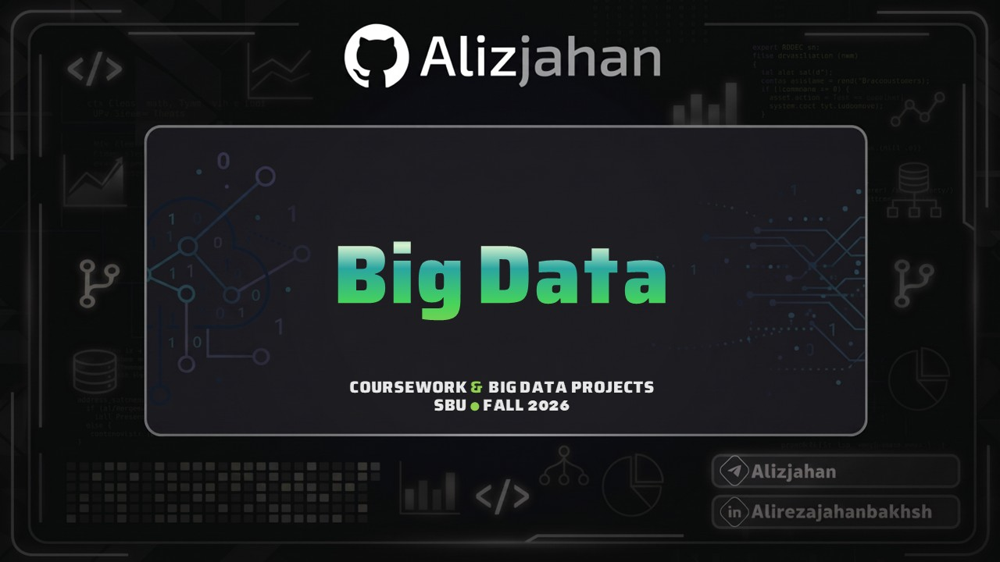

<p align="center">
  
</p>

<div align="center">

# Big Data Analytics & Massive Datasets
### Graduate Coursework, Scalable Algorithms & Distributed Computing at Shahid Beheshti University

[](https://en.sbu.ac.ir/)
[-34C6BF?style=flat-square)]()
[](http://www.mmds.org)
[](https://spark.apache.org/)
[](https://opensource.org/licenses/MIT)
[](https://github.com/Alizjahan)

Graduate-level coursework, distributed computing implementations, and algorithmic solutions for Mining of Massive Datasets (MMDS) at Shahid Beheshti University.

[Course Overview](#course-information) • [Syllabus & Chapters](#syllabus--topics-covered) • [Repository Structure](#repository-structure) • [Setup](#environment-setup) • [Maintainer & Credits](#maintainer--credits)

</div>

---

## Course Overview

This repository contains academic assignments, algorithmic problem sets, and capstone research project implementations for the **Big Data Analytics** graduate course at Shahid Beheshti University (SBU).

The course focuses on the algorithmic and theoretical principles of analyzing massive datasets where traditional in-memory algorithms fail, following the renowned Stanford University **MMDS** curriculum.

### Course Information
- **Course:** Big Data Analytics (تحلیل کلان‌داده)
- **University:** Shahid Beheshti University (SBU)
- **Department:** Faculty of Computer Science & Engineering
- **Instructor:** Dr. Mahboubeh Riahi (دکتر محبوبه ریاحی)
- **Teaching Assistant:** Tara Zare (تارا زارع)
- **Term:** Fall 2026 (Semester 4051)
- **Student / Maintainer:** [Alireza Jahanbakhsh](https://github.com/Alizjahan)
- **Primary Textbook:** *Mining of Massive Datasets* (MMDS) by Jure Leskovec, Anand Rajaraman, and Jeffrey D. Ullman (Stanford University)

---

## Syllabus & Topics Covered

The curriculum investigates key algorithmic pillars designed to extract insights from massive-scale data streams, graphs, and matrices:

| Topic | Key Algorithmic Concepts | Focus Domain |
| :--- | :--- | :--- |
| **MapReduce & Distributed Computing** | MapReduce programming model, Map/Reduce tasks, Distributed File System (DFS/HDFS), matrix multiplication | Distributed Systems |
| **Finding Similar Items (LSH)** | Shingling of documents, Min-Hashing, Locality-Sensitive Hashing (LSH), distance measures (Jaccard, Cosine) | High-Dimensional Search |
| **Mining Data Streams** | Stream data model, Sampling in streams, Bloom Filters, Flajolet-Martin counting, DGIM algorithm | Real-time Stream Analytics |
| **Frequent Itemsets & Association Rules** | Market-Basket model, A-Priori algorithm, PCY algorithm, Multistage & Multihash, Limited-Pass algorithms | Pattern Mining & Retail |
| **Clustering Massive Data** | High-dimensional clustering, BFR algorithm (Mahalanobis distance), CURE algorithm, Hierarchical clustering | Unsupervised Learning |
| **Advertising on the Web** | Online algorithms & Competitive ratio, Online bipartite matching, AdWords problem & Balance algorithm | Computational Advertising |
| **Recommendation Systems** | Content-based recommendations, Collaborative filtering (Item/User), Dimensionality reduction, SVD | Personalization Engines |
| **Mining Social-Network Graphs** | Social networks as graphs, PageRank & Random Walks, Topic-Sensitive PageRank, Community detection, SimRank | Graph Analytics & Web |

---

## Repository Structure

```text
Big-Data-SBU-Course/
├── assets/
│   └── header.jpg                  # Course header banner
├── assignments/                    # Coursework assignments and problem solutions
├── final-project/                  # Capstone big data analytics final project
├── .gitignore                      # Pre-configured exclusions for massive datasets and logs
├── LICENSE                         # MIT open-source license
└── README.md                       # Comprehensive course documentation and syllabus
```

---

## Coursework & Final Project

### 📝 Assignments (ssignments/)

| Assignment | Topic & Focus Areas | Technologies | Deliverables |
| :--- | :--- | :--- | :--- |
| **[HW1 — MapReduce & LSH](assignments/HW1/)** | Matrix Multiplication, Relational Algebra, MovieLens Rating Aggregation, Random-Hyperplane LSH on Medical Embeddings | PySpark, Sentence-Transformers, XeLaTeX | [Code & Documentation](assignments/HW1/) • [فارسی](assignments/HW1/README_FA.md) |

- **Final Project (inal-project/):** An end-to-end distributed data processing capstone project solving a real-world massive data mining challenge.

---

## Reference Materials & Textbook

- **Title:** *Mining of Massive Datasets* (3rd Edition)
- **Authors:** Jure Leskovec (Stanford), Anand Rajaraman (Morpheus), Jeffrey D. Ullman (Stanford)
- **Official Course Website:** [http://www.mmds.org](http://www.mmds.org)
- Free digital copies, lecture slides, and video resources are openly available at the Stanford MMDS portal.

---

## Environment Setup

To reproduce assignments and run big data scripts locally or on a cluster:

### Prerequisites
- Python >= 3.10
- Java JDK 8, 11, or 17 (required for Apache Spark / Hadoop)
- Apache Spark (PySpark)

### Local Environment Installation
```bash
# Clone the repository
git clone https://github.com/Alizjahan/Big-Data-SBU-Course.git
cd Big-Data-SBU-Course

# Create and activate virtual environment
python -m venv .venv
source .venv/bin/activate  # On Windows: .venv\Scripts\activate

# Install essential Big Data analytics packages
pip install pyspark numpy scipy pandas scikit-learn networkx jupyterlab
```

---

## Maintainer & Credits

- **Repository Maintainer:** [@Alizjahan](https://github.com/Alizjahan)
- **Course Instructor:** Dr. Mahboubeh Riahi
- **Teaching Assistant:** Tara Zare
- **Institution:** Shahid Beheshti University (SBU)

---

## License & Academic Integrity

This repository is licensed under the **MIT License** — see the [LICENSE](LICENSE) file for details.  
*Educational Notice: Code and notebooks are published for academic and research reference.*
